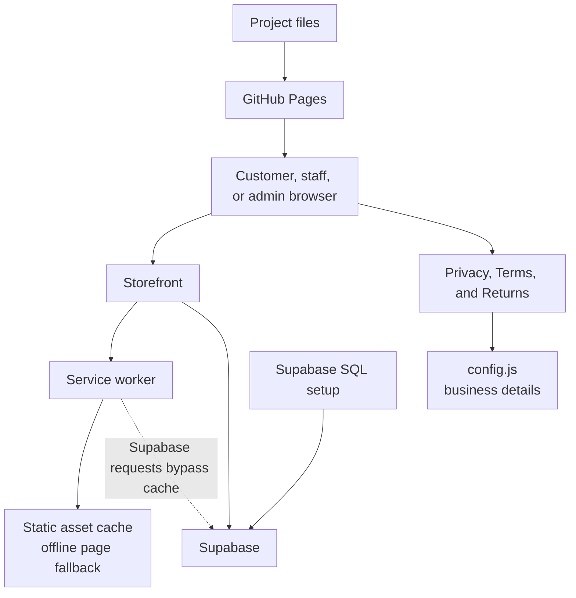
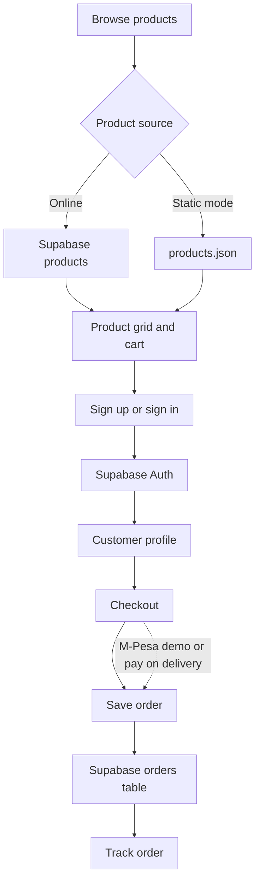
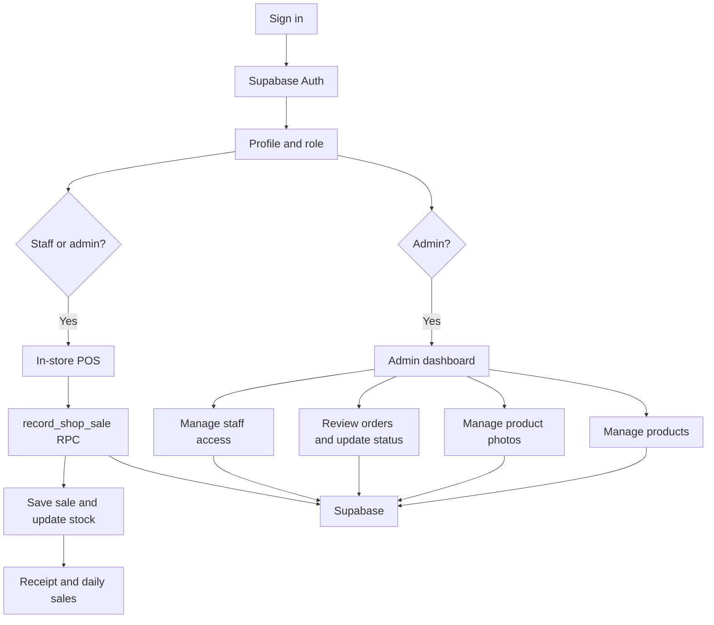

# Project flow

## Build and publish

This is a static website: there is no compile/build command. GitHub Pages serves
the files in the repository directly. Apply the Supabase SQL setup files to the
Supabase project separately.

## How the site is delivered

## Customer shopping and checkout

## Admin and in-store sales

The in-store M-Pesa prompt is currently in demo mode; staff enter the customer's
confirmation code manually.
